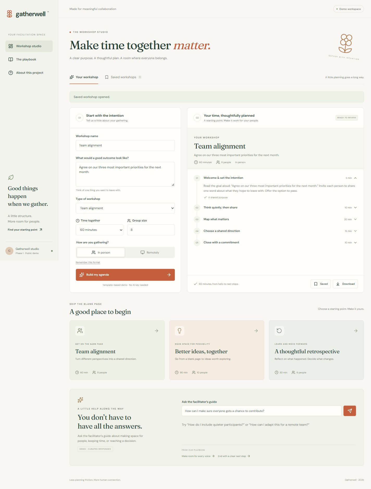

# Gatherwell

**Make time together matter.** A new workshop planning assistant for team leads and community facilitators, built as a complete Phase 1 Next.js foundation.

## Submission links

- **[GitHub repository — submit this link](https://github.com/PenielOkoli/gatherwell-phase-1)**
- **[Live Vercel application](https://gatherwell-phase-1.vercel.app)**
- Architecture notes: [docs/architecture.md](docs/architecture.md)
- Security checklist: [docs/security-checklist.md](docs/security-checklist.md)
- AI SDK boundary explanation: [docs/ai-sdk-boundary.md](docs/ai-sdk-boundary.md)
- New Module 1 product brief: [docs/product-brief.md](docs/product-brief.md)
- Requirement mapping and evidence: [docs/assessment.md](docs/assessment.md)

## Try the product

1. Choose a template or edit the workshop brief.
2. Set a 30, 60, or 90-minute duration, 2–30 participants, and in-person or remote format.
3. Build an agenda and expand the five activities to see instructions and outcomes.
4. Save on this browser or download the plan as Markdown.
5. Ask the facilitator guide about participation, timing, decisions, or remote workshops.

The public app uses deterministic templates and clearly labeled curated demo responses. No API key is needed. The real provider integration is installed and isolated on the server; public demo use does not make paid model calls. Saved workshops stay in this browser and do not sync across devices.

## Run locally

Requires Node.js 22+ and npm.

```sh
npm ci
npm run dev
```

Open `http://localhost:3000`. No environment file is required in demo mode. To inspect the configuration, copy `.env.example` to `.env.local`; never commit real credentials.

```sh
npm run typecheck
npm test
npm run build
npm start
```

`npm run check` runs type checking, boundary/domain tests, and a production build. An optional GitHub Actions workflow is included at `docs/ci-workflow.example.yml`. The available GitHub login does not have workflow-write scope, so CI is not activated; local checks were run instead. To enable it later, place that file at `.github/workflows/check.yml` using an account with the appropriate permission.

## The technical foundation

- Next.js App Router with strict TypeScript and React.
- Server-rendered page shell, playbook, and product notes.
- One interactive workspace Client Component for forms, expanded activity instructions, browser persistence, and downloads.
- Validated Server Actions for plan creation and a real HttpOnly preference-cookie mutation.
- Shared models for messages, tools, sources, workshop input, and agenda results.
- `ai` plus `@ai-sdk/openai`, accessed only from a `server-only` module.
- Route Handler with input/body limits, explicit live-mode authorization, safe errors, bounded model output, and no browser secrets.

See the architecture notes for the product-to-boundary mapping and the distinction between Server Components, Client Components, Server Actions, and Route Handlers.

## Enabling live AI for a trusted server client

The public UI stays in demo mode. For development or a controlled server-to-server integration, configure `AI_MODE=live`, `OPENAI_API_KEY`, `OPENAI_MODEL`, and a random `AI_ACCESS_TOKEN` of at least 32 characters in server environment settings. A request to `POST /api/assistant` must include `x-gatherwell-mode: live`, `Authorization: Bearer <AI_ACCESS_TOKEN>`, and a JSON body such as `{"question":"How can I include quieter participants?"}`.

Do not put the access token in client JavaScript. Public paid access requires the additional controls listed in the security checklist. The live provider branch has not been exercised with a paid API key for this submission.

## Project layout

```text
src/app/           Routes, server pages, actions, global styling
src/components/    Interactive workshop workspace
src/lib/           Catalog, runtime schemas, pure agenda logic
src/lib/server/    Server-only environment, HTTP, and AI code
src/types/         Shared domain contracts
tests/             Boundary and agenda tests
docs/              Brief, architecture, security, deployment, evidence
```

Original concept and implementation prepared on 23 October 2026. This repository is separate from the previous CoinPilot project.

## Preview



[Mobile screenshot](docs/screenshots/mobile.png) · [Deployment and verification details](docs/deployment.md)
