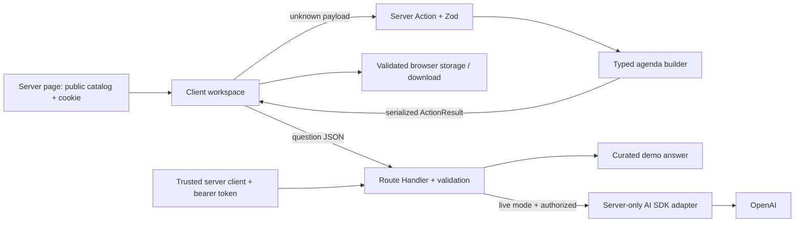

# Architecture and server/client boundary notes

## Stack and organization

Next.js App Router, React, strict TypeScript, Zod, `ai`, and `@ai-sdk/openai`. The lockfile pins the installed dependency graph. CSS and locally bundled fonts create the interface without an external font request.

```text
src/app/layout.tsx             Server Component: shared shell and metadata
src/app/page.tsx               Server Component: reads preference and passes public data
src/app/playbook/page.tsx      Server Component: original facilitation notes
src/app/about/page.tsx         Server Component: scope and privacy explanation
src/components/workspace.tsx  Client Component: interaction and browser storage
src/app/actions.ts            Server Actions: validated plan building and cookie mutation
src/app/api/assistant/route.ts Route Handler: assistant HTTP boundary
src/lib/server/               server-only settings, HTTP reader, and AI integration
src/lib/planner.ts            Pure typed domain logic
src/lib/validation.ts         Shared runtime schemas (no secrets)
src/types/domain.ts           Serializable domain contracts
```

## What the three component/function categories mean

A Server Component renders on the server and can access server-side resources. It does not send its implementation to the browser. Gatherwell's page reads an HttpOnly preference cookie and sends only a validated format and public catalog to the interactive workspace. Calling `cookies()` makes the home page dynamic. The playbook and about page can be prerendered.

A Client Component is an interactive boundary marked with `"use client"`. It can be prerendered into HTML on the server, then hydrated in the browser. It is not accurate to say that it only ever renders in the browser. State, events, localStorage, downloads, and focus management belong here. Browser APIs run in effects or event handlers, not at module import or during server rendering. The shared layout stays outside the client subtree.

A Server Action is a server function marked with `"use server"` that the UI invokes through Next.js. It is not a Server Component and does not become private merely because its button is hidden. It is a remotely reachable input boundary. `createWorkshop` validates an unknown payload, computes the plan, and returns a discriminated result. `savePreferredFormat` validates a small enum and mutates an HttpOnly cookie. Neither writes a global file or exposes another user's data. Next.js provides action request/origin safeguards; these are not a substitute for authorization when private records are added.

## Product brief → responsibilities

| Product capability | Server responsibility | Client responsibility | Evidence |
|---|---|---|---|
| Show the studio | Render shell; read format preference; pass public templates | Hydrate the interactive workspace | `app/page.tsx`, `app/layout.tsx` |
| Choose a starting point | Own the public template catalog | Copy selected template into editable state | `lib/catalog.ts`, `components/workspace.tsx` |
| Build a workshop | Validate enums, lengths and numbers; compute agenda | Capture values; show pending/errors; display the result | `app/actions.ts`, `lib/validation.ts`, `lib/planner.ts` |
| Remember format | Validate input and write secure HttpOnly cookie | Request the preference update; report result | `savePreferredFormat`, `lib/server/settings.ts` |
| Save and reopen | No database in Phase 1 | Validate localStorage data; save, reopen, remove | `storedPlanSchema`, workspace handlers |
| Download agenda | Supply plain-text validated plan data | Create a local Blob and download Markdown | workspace `download` handler |
| Ask the guide | Limit request size; validate question; enforce live authorization; call SDK if enabled | Submit question; render escaped text and errors | `api/assistant/route.ts`, `lib/server/ai.ts` |
| Explain sources | Serve original playbook content | Navigate to stable internal links | `playbook/page.tsx`, `Source` contract |

## Data flow



## Types and trust

`WorkshopInput`, `WorkshopPlan`, `AgendaStep`, `Message`, `Source`, `ToolDefinition`, and `ActionResult<T>` are plain serializable contracts. `Message` carries its role and mode; `Source` distinguishes our original internal notes from external evidence; `ToolDefinition` documents the typed planner capability and where it executes. The planner is currently called by a Server Action, not granted to a language model as a tool. Future SDK tool registration must use the same runtime schema and explicit permissions.

TypeScript verifies code at compile time. It does not prove that an HTTP request, cookie, or browser storage is valid. Zod validates the external data at runtime. The server never trusts browser validation alone. React renders input and model output as text; no raw HTML or model-selected URL is inserted.

## Technical references

- [Next.js Server and Client Components](https://nextjs.org/docs/app/getting-started/server-and-client-components)
- [Next.js Mutating Data / Server Functions](https://nextjs.org/docs/app/getting-started/mutating-data) — current replacement for the curriculum's older updating-data URL.
- [Next.js environment variables](https://nextjs.org/docs/app/guides/environment-variables)
- [TypeScript Handbook](https://www.typescriptlang.org/docs/handbook/intro.html)

Accessed 23 October 2026. Project-specific design choices and limits are described above rather than inferred from framework defaults.
